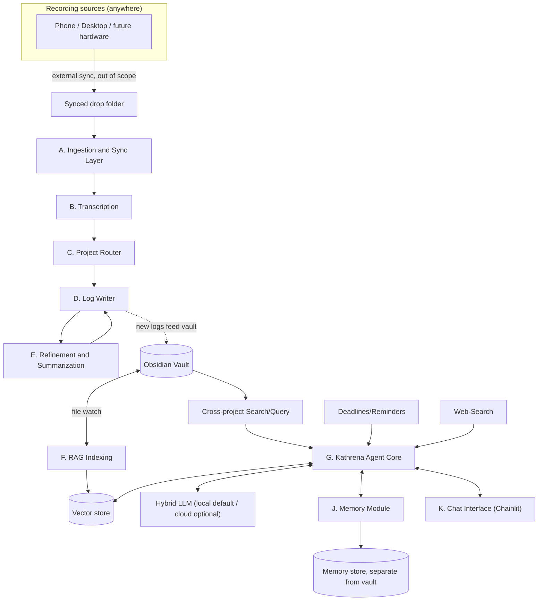

Mark 2 of the original Accelerate project. Mk2 splits into two cooperating halves: a rebuilt, modular **voice-log pipeline**, and a new conversational AI companion named **Kathrena** with RAG access to the whole Obsidian vault.

## Architecture

!See [Architecture Overview](Architecture%20Overview.md) for the full breakdown of each component.

## Start here
- [Decisions Log](Decisions%20Log.md) - choices we've locked in and why
- [Further Considerations](Further%20Considerations.md) - open questions to resolve before the detailed build plan

## Modules
- [A - Ingestion and Sync Layer](Modules/A%20-%20Ingestion%20and%20Sync%20Layer.md)
- [B - Transcription Module](Modules/B%20-%20Transcription%20Module.md)
- [C - Project Router Module](Modules/C%20-%20Project%20Router%20Module.md)
- [D - Log Writer Module](Modules/D%20-%20Log%20Writer%20Module.md)
- [E - Refinement and Summarization Module](Modules/E%20-%20Refinement%20and%20Summarization%20Module.md)
- [F - RAG Indexing Module](Modules/F%20-%20RAG%20Indexing%20Module.md)
- [G - Kathrena Agent Core](Modules/G%20-%20Kathrena%20Agent%20Core.md)
- [H - Change Proposal and Approval Gate](Modules/H%20-%20Change%20Proposal%20and%20Approval%20Gate.md)
- [I - Project Management Modules](Modules/I%20-%20Project%20Management%20Modules.md)
- [J - Memory Module](Modules/J%20-%20Memory%20Module.md)
- [K - Chat Interface](Modules/K%20-%20Chat%20Interface.md)
