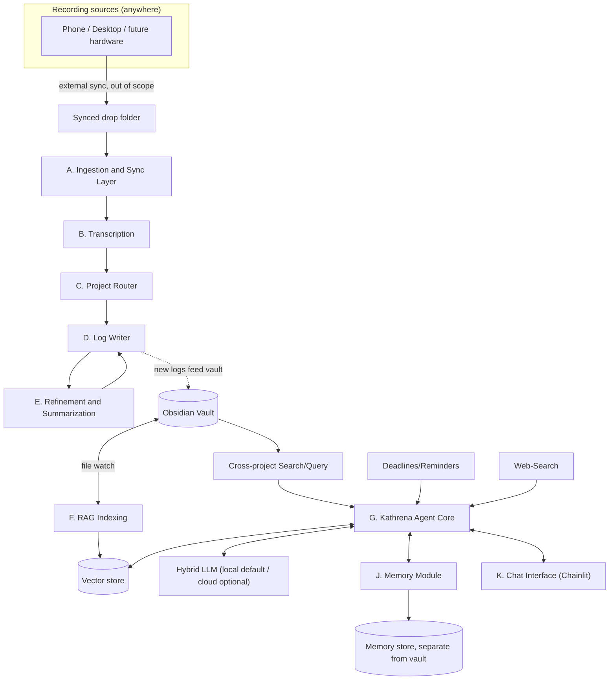

Two halves sharing a vault and one safety gate: the voice-log pipeline (A-E) turns speech into project logs, and the Kathrena agent (F-J) reads the whole vault, remembers her own experiences separately, chats/listens, and proposes changes.

## Diagram

## Components
- **[A - Ingestion and Sync Layer](Modules/A%20-%20Ingestion%20and%20Sync%20Layer.md)** - watches a synced drop folder for new audio, source-agnostic by design.
- **[B - Transcription Module](Modules/B%20-%20Transcription%20Module.md)** - speech-to-text, Whisper-family, swappable.
- **[C - Project Router Module](Modules/C%20-%20Project%20Router%20Module.md)** - matches a transcript to a project via the synonym map.
- **[D - Log Writer Module](Modules/D%20-%20Log%20Writer%20Module.md)** - writes the final log into the project's `Ω - logs` folder.
- **[E - Refinement and Summarization Module](Modules/E%20-%20Refinement%20and%20Summarization%20Module.md)** - cleans up and summarizes the raw transcript.
- **[F - RAG Indexing Module](Modules/F%20-%20RAG%20Indexing%20Module.md)** - keeps a searchable vector index of the vault up to date.
- **[G - Kathrena Agent Core](Modules/G%20-%20Kathrena%20Agent%20Core.md)** - the conversational companion, reachable by push-to-talk or chat, with tools for the vault, memory, deadlines, and web search.
- **[H - Change Proposal and Approval Gate](Modules/H%20-%20Change%20Proposal%20and%20Approval%20Gate.md)** - the safety gate for every proposed vault write.
- **[I - Project Management Modules](Modules/I%20-%20Project%20Management%20Modules.md)** - four independent task/status/reminder/search modules.
- **[J - Memory Module](Modules/J%20-%20Memory%20Module.md)** - Kathrena's persistent memory of conversations and people, kept separate from the vault.
- **[K - Chat Interface](Modules/K%20-%20Chat%20Interface.md)** - the Chainlit-based UI where you talk to Kathrena (text or voice), review proposals, and hear her talk back via text-to-speech.
- **[L - Screen Perception Module](Modules/L%20-%20Screen%20Perception%20Module.md)** - *planned, not built* - lets Kathrena see the active window on screen, on-demand now with a proactive stretch goal, blocked on verifying TextGen's vision support. See Decisions Log Round 22.

## Data flow summary
Audio dropped anywhere syncs into a watched folder, gets transcribed, routed to a project, summarized, and written as a log - which becomes part of the vault like anything else. The vault is continuously re-indexed for RAG, which powers Kathrena and the project-management modules. Kathrena also maintains her own memory, separate from the vault, so she can recall past conversations and people over time.

## Runtime architecture
One long-running Python process hosts [K - Chat Interface](Modules/K%20-%20Chat%20Interface.md) (Chainlit) as the entry point, calling Kathrena's LangGraph graph directly via `.invoke()`/`.stream()`. Kathrena's graph is rebuilt and recompiled fresh on every call rather than held as one persistent instance - simpler than keeping a shared graph consistent across concurrent conversations, and what lets an LLM profile switch (Round 27) take effect on Kathrena's very next turn with no restart. A shared LangGraph and memory sqlite store so state survives restarts without any external service. Background threads/asyncio tasks in the same process run the push-to-talk hotkey listener (Round 18) and [I4](Modules/I%20-%20Project%20Management%20Modules.md)'s sub-agent - I3 (deadlines) is an on-demand skill instead (Round 20), so it needs no background thread of its own. Every module's configuration is read from a single `data/settings.yaml`, via `kathrena.settings` (Round 25), rather than each module owning its own env vars.

The voice-log pipeline ([A - Ingestion and Sync Layer](Modules/A%20-%20Ingestion%20and%20Sync%20Layer.md) through [E - Refinement and Summarization Module](Modules/E%20-%20Refinement%20and%20Summarization%20Module.md)) and [F - RAG Indexing Module](Modules/F%20-%20RAG%20Indexing%20Module.md)'s vault watcher run as separate background tasks - independent of the live chat agent, since they only need disk access to the vault. A third process, a shared `chroma run` server, is what actually owns the vector index now (Round 33) - the chat app and the indexer are both just HTTP clients of it, rather than each opening their own embedded Chroma client against the same files (which didn't reliably see each other's writes).
