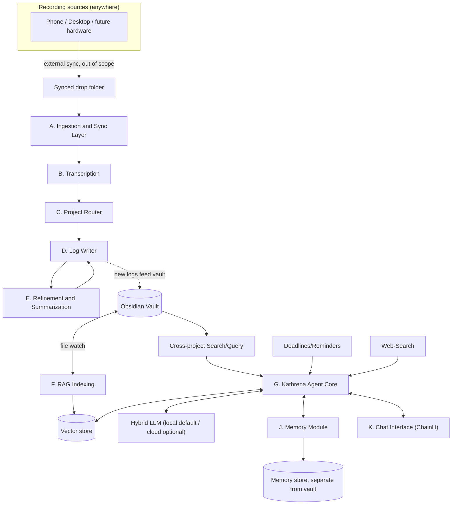
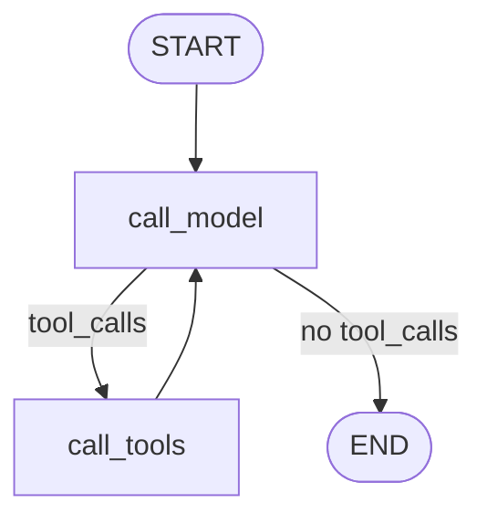

# Accelerate Mk2 (Kathrena)

[](https://github.com/Jesper-Venneman/Accelerate-Mk2/actions/workflows/ci.yml)
[](LICENSE)


Kathrena or the projects codename Accelerate Mk2 is a project I started to create a local-first,
self-hosted agentic AI system built on **LangGraph** and retrieval-augmented generation to help
with organizing my obsidian vault and give me easier access to the knowledge within. The goal
was to create something more personal, for that reason it also has a long term memory system and
a text to speech module, allowing for voice output next to the text.

The project extends on the Mk1 which originally only had the ability to process voice logs.
These voice logs are sorted into the projects or appended onto a daily log to keep track of
information I thought of or received during the day (but was too lazy to write down... many such
cases...).

Below you can find more information about the current features in the project, and the designs.
You're free to use this project yourself, either 1:1 or as a basis to build something for yourself.

## Contents

- [Features](#features)
- [Architecture](#architecture)
- [Tech stack](#tech-stack)
- [Getting started](#getting-started)
- [License](#license)

## Features

The project is split in 3 major points:
- The AI agent
  - Web interface to interact with the agent.
  - Tool calling LLM to handle requests, can access:
    - Current Date
    - RAG indexed vault
    - Access files within the vault for broader inspection.
    - Web-Search
    - Memory Retrieval
    - Deadline reminders
    - Setting modifications (switching between cloud and local modes, or specific settings)
    - ~~Suggest changes~~ To be rebuild with a more robust implementation.
  - Can receive input via text or voice input. (using hotkey push to talk)
  - Responds in text, and in voice if the input was voice too, allowing for hands off control.
    - Always respond with voice is a toggle in the settings.yaml.

- The RAG Indexer
  - Runs alongside agent web UI. (can be run on its own)
  - Index the obsidian vault.
  - Watch for changes while running and auto-update.

- The Voice-log Pipeline
  - Processes voice logs from external sources.
  - Transcribe the log, and summarize it using AI.
  - Sorts voice logs based on project name, or as general log.
  - Adds them into the obsidian vault to be indexed.

### Tests
A test suite is available that fakes every LLM call, model load, and settings file, so it runs
fast with no GPU, API key, or real vault required.

## Architecture



On input the system will call upon its available tools if it decides they are needed:


The full breakdown of every component, the runtime architecture, and the reasoning behind every
technical choice (including the ones that got reversed after real testing) lives in the
[`Architecture/`](Architecture/Accelerate%20Mk2.md) folder:

- [Architecture Overview](Architecture/Architecture%20Overview.md) - components and runtime design
- [Decisions Log](Architecture/Decisions%20Log.md) - every major technical choice, and why
- [Further Considerations](Architecture/Further%20Considerations.md) - open questions, not yet resolved
- [Modules/](Architecture/Modules/) - one design spec per lettered module

## Tech stack

| Area | Choice |
| --- | --- |
| Agent orchestration | [LangGraph](https://github.com/langchain-ai/langgraph) - hand-rolled tool-calling graphs |
| LLM access | [LangChain](https://github.com/langchain-ai/langchain) both local and cloud connections supported |
| Vector store | [Chroma](https://github.com/chroma-core/chroma), via a single shared `chroma run` server |
| Embeddings | `BAAI/bge-small-en-v1.5` via `sentence-transformers` |
| Long-term memory | [LangMem](https://github.com/langchain-ai/langmem) |
| Transcription | `openai-whisper` |
| Text-to-speech | Kokoro-82M + Pedalboard voice effects(for that sci-fi robot voice :D) |
| Chat UI | [Chainlit](https://github.com/Chainlit/chainlit) |
| Web search | DuckDuckGo via `ddgs` |

Every choice above (and every alternative considered and rejected) is written in the documentation
of the architecture folder.

## Getting started

### Setup

```powershell
.\scripts\setup-venv.ps1
```

This creates `.venv` and installs the project dependencies, including the CUDA-enabled PyTorch
build. On a machine without an NVIDIA GPU, use `./scripts/setup-venv.ps1 -CudaIndex cpu`.

### Configure

Settings live in `data/settings.yaml` (auto-created with every default the first time you run
anything). Edit `common.vault_root` to point at your Obsidian vault before running for real.
Also note the LLM profiles for both cloud and local running and set up the desired option(s).

There are many more options to play with, see below what those are:

<details>
<summary>Full <code>data/settings.yaml</code> reference</summary>

Every section below is seeded with its defaults the first time it's read - you never need to
write these yourself, just edit the values you want to change.

#### **common** - shared by every module that touches the vault
| Key | Default | What it does |
| --- | --- | --- |
| `vault_root` | `.` | Path to your Obsidian vault. Everything breaks until you point this at a real vault. |

#### **llm_profiles** - named LLM connections, picked by name per role below (`local`/`cloud` seeded by default)
| Key | Default | What it does |
| --- | --- | --- |
| `<name>.provider` | `openai` | Passed to `init_chat_model` - any provider LangChain supports. |
| `<name>.base_url` | local: `http://127.0.0.1:5000/v1`, cloud: unset | Where to send requests - a local TextGen-compatible server, or a cloud API. |
| `<name>.model` | local: `local-model`, cloud: unset | Model name/ID for that endpoint. |
| `<name>.api_key` | local: `not-needed`, cloud: unset | API key, if the endpoint needs one. |
| `<name>.max_tokens` | local: `null` (uncapped), cloud: `8192` | Caps a single reply's generation length - worth keeping capped for any paid endpoint. |

#### **agent_core** - AI's conversational core (Module G)
| Key | Default | What it does |
| --- | --- | --- |
| `agent_name` | `Kathrena` | Just a label. |
| `checkpoint_path` | `./data/agent_core_checkpoints.sqlite` | Conversation history persistence - lets a thread survive a restart. |
| `tool_profile` | `local` | Which `llm_profiles` entry decides which tool(s) to call. |
| `reply_profile` | `local` | Which `llm_profiles` entry writes the reply actually shown |
| `rag_top_k` | `4` | How many vault chunks `search_vault` retrieves per call. |
| `web_search_max_results` | `5` | How many hits `search_web` retrieves per call. |
| `read_file_max_chars` | `20000` | Truncation cap for `read_vault_file`. |
| `history_window_messages` | `12` | How many recent messages actually get sent to the LLM each turn (the saved history itself stays full-length). |
| `system_prompt` | a generic friendly default | AI's personality/behavior - freely editable without touching code. |

#### **web_search**
| Key | Default | What it does |
| --- | --- | --- |
| `enabled` | `true` | Whether the `search_web` tool is registered at all. |

#### **push_to_talk**
| Key | Default | What it does |
| --- | --- | --- |
| `hotkey_name` | `scroll_lock` | Any `pynput.keyboard.Key` name. |
| `min_utterance_seconds` | `0.3` | Shorter recordings are treated as an accidental tap, not a question. |
| `max_utterance_seconds` | `120.0` | Safety cap on recording length. |

#### **chat_interface** - Chainlit UI and voice output (Module K)
| Key | Default | What it does |
| --- | --- | --- |
| `voice_output_enabled` | `true` | Master switch for spoken replies. |
| `always_speak` | `false` | Speak every reply, not just ones that came in via voice. |
| `kokoro_lang_code` / `kokoro_voice` | `a` / `af_heart` | Kokoro TTS voice selection. |
| `pitch_shift_semitones` | `-2.0` | Voice-persona effect. |
| `highpass_cutoff_hz` | `150.0` | Voice-persona effect. |
| `distortion_drive_db` | `6.0` | Voice-persona effect. |
| `chorus_rate_hz` / `chorus_depth` | `1.5` / `0.25` | Voice-persona effect. |

#### **pipeline** - the voice-log pipeline (Modules A-E)
| Key | Default | What it does |
| --- | --- | --- |
| `whisper_model_size` | `medium` | Any `openai-whisper` model size. |
| `whisper_device` | `cuda` | Set to `cpu` if you don't have an NVIDIA GPU. |
| `llm_profile` | `local` | Which `llm_profiles` entry Module E's refiner/summarizer uses. |

#### **memory** - Kathrena's long-term memory (Module J)
| Key | Default | What it does |
| --- | --- | --- |
| `store_path` | `./data/memory.sqlite` | Where memories are persisted. |
| `embedding_dims` | `384` | Embedding dims for memory search - keep in sync with `embedding_model_name` if you change the model. |
| `embedding_model_name` | `BAAI/bge-small-en-v1.5` | Embedding model for memory search - keep these in sync with `embedding_dims` if you change the model. |
| `llm_profile` | `local` | Which `llm_profiles` entry extracts/writes memories. |
| `search_limit` | `5` | How many memories `search_memory` returns per call. |
| `reflection_delay_seconds` | `360.0` | How long a conversation must sit idle before background memory extraction runs. |
| `marker_overlap_messages` | `2` | Overlap kept between successive memory-extraction submissions, for continuity. |

#### **project_management**
| Key | Default | What it does |
| --- | --- | --- |
| `default_within_days` | `30` | `list_deadlines`' default lookahead window. |
| `due_frontmatter_key` | `due` | Vault notes carry a due date via this frontmatter field. |

#### **rag_index** - vault indexing (Module F)
| Key | Default | What it does |
| --- | --- | --- |
| `persist_directory` | `./chroma` | Where the Chroma *server* persists its data (passed to `chroma run --path`) - not read directly by the Python client anymore. |
| `chroma_host` / `chroma_port` | `127.0.0.1` / `8601` | Where the shared Chroma server (a sibling process, see `start.ps1`) is listening. |
| `chroma_connect_retries` / `chroma_connect_retry_delay_seconds` | `10` / `1.0` | How long to retry connecting if the server hasn't finished starting yet. |
| `collection_name` | `vault` | Chroma collection name. |
| `embedding_model_name` | `BAAI/bge-small-en-v1.5` | Same model used for vault search as for memory. |
| `chunk_size` / `chunk_overlap` | `1000` / `150` | Text-splitting parameters for indexing. |
| `watch_quiet_period_seconds` | `30.0` | Delay before indexing a changed file, so an in-progress file isn't indexed half-written. |

#### **llm_logging**
| Key | Default | What it does |
| --- | --- | --- |
| `path` | `./data/logs/llm_calls.log` | Plain-text log of LLM/tool calls, rotated daily, last 10 days kept. |

</details>


### Run

```powershell
.\start.ps1
```

Starts the Chroma server, the chat app, and the RAG indexer together, since the vault needs to
actually be indexed for `search_vault` to find anything - all three talk to the same Chroma
server over HTTP, rather than each opening their own embedded client (see the Decisions Log's
Round 33 for why that didn't work). `Ctrl+C` stops all three.

To run just the chat app on its own (e.g. with `-w` for auto-reload on code changes, which
`start.ps1` doesn't pass through) - note it still needs the Chroma server reachable, so run
`.venv\Scripts\chroma.exe run --path ./chroma --host 127.0.0.1 --port 8601` first if you're not
using `start.ps1`:

```powershell
.venv\Scripts\chainlit.exe run src/kathrena/chat_interface/app.py -w
```

### Test

```powershell
pytest -q
ruff check .
```

## License

[MIT](LICENSE)

