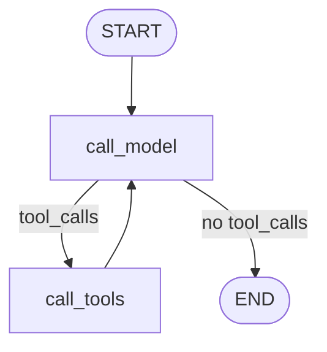

# Kathrena Agent Core (Module G)

Kathrena's conversational LangGraph agent - a hand-rolled tool-calling loop (`call_model` <->
`call_tools`) using the same local TextGen LLM as Module E (Refinement and Summarization).
Also includes push-to-talk voice input (`kathrena.agent_core.push_to_talk`) and web search
(`kathrena.agent_core.web_search`) - see their sections below.
Long-term memory (Module J) is wired in via the optional `memory_provider` param -
see this file's Tools section below. See `Architecture/Modules/G - Kathrena Agent Core.md` for the
design spec.



## Install

No new dependencies beyond what's already in `pyproject.toml` (`langgraph`,
`langgraph-checkpoint-sqlite`, `langchain`, `langchain-openai`, `pynput`, `sounddevice`,
`soundfile`). Needs a running TextGen (or any OpenAI-compatible, tool-calling-capable) server -
see `src/kathrena/voice_log/README.md` for the shared `.venv` setup.

## Configure

| Settings key | Default | Purpose |
| --- | --- | --- |
| `agent_core.checkpoint_path` | `./data/agent_core_checkpoints.sqlite` | Conversation history checkpoint DB - lets a chat thread survive a restart |
| `agent_core.tool_profile` | `local` | Which named `llm_profiles` entry (see `kathrena.llm`) decides which tool(s) to call |
| `agent_core.reply_profile` | `local` | Which named `llm_profiles` entry writes the reply actually shown - differs from `tool_profile` only in `"standard"` mode |
| `agent_core.rag_top_k` | `4` | How many vault chunks `search_vault` retrieves per call |
| `agent_core.read_file_max_chars` | `20000` | Safety cap on `read_vault_file`'s output before it truncates |
| `web_search.web_search_max_results` | `5` | How many hits `search_web` retrieves per call (whether the tool exists at all is `web_search.enabled`, see Web search below) |
| `agent_core.history_window_messages` | `12` | Caps how many of a thread's messages `call_model`/`call_reply_model` actually send the LLM each turn - the checkpointed history itself stays full-length |
| `agent_core.system_prompt` | (full personality text) | Personality/behaviour system prompt - editable without touching code. The always-available-tools sentence stays hardcoded in `graph.py` regardless |

## Usage

```python
from kathrena.agent_core import AgentCoreConfig, run_turn
from kathrena.rag_index.config import RagIndexConfig
from kathrena.rag_index.vector_store import ChromaVectorStore

config = AgentCoreConfig()
vector_store = ChromaVectorStore(RagIndexConfig())

result = run_turn(config, vector_store, thread_id="some-chat-session", user_text="What's the status of Project Foo?")
print(result.reply)
```

`kathrena.chat_interface` (Module K) is the actual caller of `run_turn` in practice - see its
README for the Chainlit app that wires this up to a real chat UI.

## Tools

- **`search_vault(query)`** - semantic search over the vault via `kathrena.rag_index`'s
  `VectorStore.search` (Module F).
- **`read_vault_file(path, near_text)`** - reads a vault note, given the path `search_vault`
  surfaced it under. Pass `near_text` (the exact excerpt `search_vault` returned) to get a
  `AGENT_READ_FILE_MAX_CHARS`-sized window centered on that excerpt within the file, instead of
  the whole thing - matching is whitespace/punctuation-tolerant, so minor re-typing/formatting
  differences in `near_text` still line up. Omit it (or if no match is found) to fall back to the
  full file, truncated past `AGENT_READ_FILE_MAX_CHARS`. Always available (no optional
  collaborator needed), reads directly off disk via `AgentCoreConfig.vault_root` - deliberately
  ignores the `rag-index: false` opt-out (Decisions Log Round 24).
- **`set_llm_mode(mode)`** - switches every LLM-using role (`pipeline`/`agent_core`/`memory`) to a
  named preset in one call: `"local"`, `"cloud"`, or `"standard"` (cloud only for
  `agent_core.reply_profile`, local everywhere else) - see LLM modes below (Decisions Log
  Round 28).
- **`change_setting(name, value)`** - a more generic, allow-listed settings writer for switching a
  single role's profile without applying a whole mode. Allowed names:
  `pipeline.llm_profile`, `agent_core.tool_profile`, `agent_core.reply_profile`,
  `memory.llm_profile`. Secrets/paths/`vault_root` are never allow-listed.
- **`search_memory(query)`** - recalls facts/preferences/past conversations about the user from
  `kathrena.memory` (Module J), separate from vault content. Only available when `run_turn`/
  `build_agent_graph` is given a `memory_provider` - omit it (the default) and Kathrena has no
  memory tool at all. When a `memory_provider` is given, `run_turn` also passes the full
  conversation history to `memory_provider.remember(...)` after each turn, so LangMem's debounced
  background extraction eventually sees the whole conversation, not just the latest exchange - see
  `src/kathrena/memory/README.md` and `Architecture/Decisions Log.md` Round 19.
- **`get_current_datetime()`** - the current local date/time. Always available (no optional
  collaborator needed) - see `Architecture/Decisions Log.md` Round 21.
- **`list_deadlines(within_days)`** - vault notes with a `due:` frontmatter date within
  `within_days` days (always includes overdue ones), soonest first. An on-demand skill - Kathrena
  checks when asked, never surfaces this unprompted. Only available when given a `pm_config`
  (`kathrena.project_management.ProjectManagementConfig`) - see Decisions Log Round 20.
- **`search_web(query)`** - public internet search via DuckDuckGo, for anything current or not in
  the vault/memory. Only available when given a `web_search` (`kathrena.agent_core.web_search`) -
  see its section below and Decisions Log Round 21.

## Test

```powershell
.venv\Scripts\python.exe -m pytest tests/agent_core -q
```

Every test runs against a scripted fake chat model (`tests/agent_core/conftest.py`'s
`ScriptedChatModel`) and a fake vector store - no real LLM/TextGen server or embeddings model
needed, same pattern as `tests/rag_index`.

## Push-to-talk voice input (`kathrena.agent_core.push_to_talk`)

Replaces an earlier wake-word listener that turned out unstable and resource-heavy in practice -
see `Architecture/Decisions Log.md` Round 18. `PushToTalkListener` runs a global keyboard hook
(via `pynput`) that:

1. Watches one configured key system-wide, regardless of which window has focus - and never
   suppresses it, so the key still works normally for anything else that might use it.
2. On press, starts streaming audio from the microphone (`microphone.StreamingRecorder`).
3. On release, stops recording and transcribes it via `kathrena.voice_log.transcription`
   (Module B) on a background thread (never on pynput's own callback thread - its docs warn that
   blocking calls there risk freezing keyboard/mouse input system-wide).
4. If the transcript is empty (an accidental tap, or a normal press of that key elsewhere),
   nothing is sent.

Finished utterances land in `listener.utterances`, an `asyncio.Queue[str]` -
`kathrena.chat_interface.app` awaits from it and feeds each one into `run_turn` like a typed
message. Started via `listener.start(loop)`/stopped via `listener.stop()`, scoped to one Chainlit
session's lifetime (see Module K's README). A `threading.Timer` safety cutoff
(`max_utterance_seconds`) stops a recording if the key-release event is ever missed.

**Platform note:** works on Windows and Linux/X11. Native Wayland sessions restrict global input
listening for security reasons - a compositor design choice, not something any library can fully
work around.

| Settings key | Default | Purpose |
| --- | --- | --- |
| `push_to_talk.hotkey_name` | `scroll_lock` | Any `pynput.keyboard.Key` name (e.g. `pause`, `f13`) - pick a key your keyboard has that nothing else relies on |
| `push_to_talk.max_utterance_seconds` | `120.0` | Safety cap if a key-release event is ever missed |
| `push_to_talk.min_utterance_seconds` | `0.3` | Recordings shorter than this are discarded before ever reaching Whisper - key bounce (a single press firing several rapid press/release pairs, worse on some keyboards for toggle keys like Scroll Lock) produces tiny clips that also happen to crash openai-whisper's decoder |

Tests (`tests/agent_core/test_push_to_talk_listener.py`) inject a fake recorder and fake
transcriber - no real keyboard hook, microphone, or Whisper model needed.

## Web search (`kathrena.agent_core.web_search`)

Gives Kathrena's `search_web` tool a real internet backend - DuckDuckGo via the `ddgs` package,
free and no API key/account needed (Decisions Log Round 21). Kept behind a `WebSearch` Protocol
(`search(query, max_results) -> list[SearchHit]`), the same swappable pattern as
`kathrena.rag_index.VectorStore` and `kathrena.memory.MemoryProvider`, so the backend can change
later (e.g. Tavily) without touching `kathrena.agent_core.tools`/`graph`.

| Settings key | Default | Purpose |
| --- | --- | --- |
| `web_search.enabled` | `true` | Whether `kathrena.chat_interface.app` constructs a `DuckDuckGoWebSearch` at all - `false` means Kathrena has no `search_web` tool |

```python
from kathrena.agent_core.web_search import DuckDuckGoWebSearch, WebSearchConfig

if WebSearchConfig().enabled:
    web_search = DuckDuckGoWebSearch()
    # pass web_search=web_search into run_turn/build_agent_graph
```

Tests use a `FakeWebSearch` (`tests/agent_core/conftest.py`) - no real network call needed.

## Lint

```powershell
.venv\Scripts\python.exe -m ruff check src/kathrena/agent_core tests/agent_core
```

